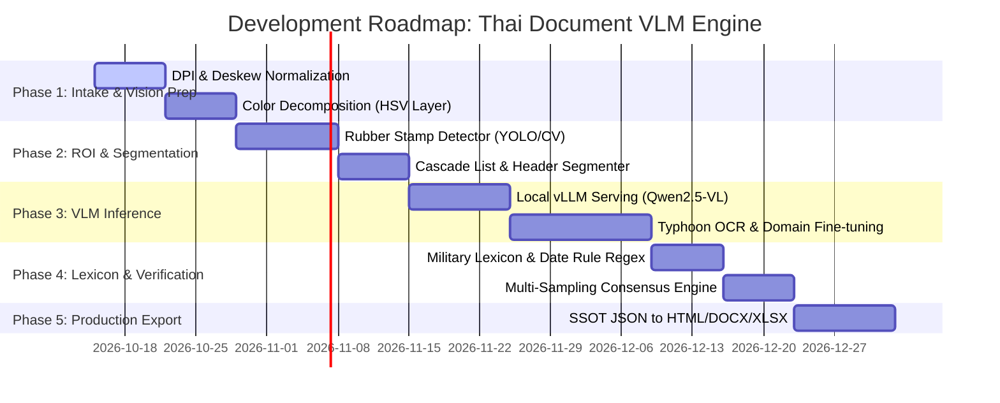

# 🚀 PROJECTPLAN: Autonomous Thai Document & Forensic VLM Engine
> **แผนการพัฒนาเอนจินสกัดเอกสารราชการ ลายมือ และตรายางไทยความแม่นยำสูง (Precision OCR & Superclone)**

---

## 🎯 Project Goals (เป้าหมายหลัก)
1. สร้าง **End-to-End Autonomous Pipeline** สำหรับแปลงภาพสแกนเอกสารราชการไทย (PDF/Image) เป็นข้อมูล Structured JSON และ Rebuild เป็น HTML, Word (.docx), Excel (.xlsx) ที่แม่นยำ 100%
2. รองรับการอ่าน **ลายมือมนุษย์ ตัวเลขไทย ตรายาง และลายเซ็น** โดยไม่มีสระลอย วรรณยุกต์หลุด หรือคำย่อทางทหารเพี้ยน
3. รองรับการทำงานแบบ **Offline Local Serving (vLLM / Ollama)** เพื่อรักษาความลับสูงสุดตามมาตรฐาน PDPA / ความมั่นคง

---

## 🗺️ Roadmap & Milestones (แผนผังการพัฒนา 5 ระยะ)

---

## 📋 Task Breakdown & Technical Specifications

### Phase 1: Computer Vision Pre-processing Pipeline
- [ ] **Task 1.1: Standardized Resolution Normalizer**
  - บังคับแปลงไฟล์ PDF ขาเข้าเป็นภาพ PNG ความละเอียดคงที่ **300 DPI** เสมอ
  - กำจัด Noise รอบขอบตัวหนังสือด้วย Bilateral Filter
- [ ] **Task 1.2: Automatic Deskew & Dewarping**
  - ตรวจจับมุมเอียงของเอกสาร (Hough Line Transform / MinAreaRect) และหมุนกลับมา 90 องศา
  - รองรับการคลี่หน้ากระดาษที่โค้งงอตามสันแฟ้ม (DocTr Dewarping)
- [ ] **Task 1.3: Optical Color Decomposition (แยกหมึกตรายาง/ปากกา)**
  - ใช้ Color Filtering (HSV/LAB) แยกสีหมึกพิมพ์ตรายางออกจากหมึกปากกาลายมือ เพื่อตัดจุดไข่ปลา `......` ไม่ให้กวนเส้นตัวเลข

### Phase 2: Smart Layout & ROI Slicing
- [ ] **Task 2.1: Rubber Stamp & Header Bounding Box Detector**
  - ตีกรอบสี่เหลี่ยมพิกัดกล่องตรายางรับสารอัตโนมัติ (มุมบนซ้ายและขวา)
  - Crop ขยายความละเอียดเฉพาะจุด (Region of Interest) ก่อนส่งให้ AI
- [ ] **Task 2.2: Multi-Page Grid & Contact Sheet Orchestrator**
  - นำหน้าที่เกี่ยวข้องกันมาร้อยเรียงเพื่อส่งบริบทภาพรวม (Global Context) ป้องกันข้อความข้ามหน้าหลุด
- [ ] **Task 2.3: Signature Block Heuristic Detector**
  - ผูกตรรกะตรวจจับคำว่า `(ลงชื่อ)`, ยศ, ชื่อ, ตำแหน่ง ชนแกน **Universal Red Line Standard**

### Phase 3: High-Precision VLM Engine Setup
- [ ] **Task 3.1: Private Local Inference Engine (vLLM)**
  - ติดตั้ง `vLLM` รองรับโมเดล **Qwen2.5-VL-7B-Instruct** (Quantization: AWQ/4-bit บน GPU RTX 12GB+)
  - ตั้งค่า Default Decoding: `temperature=0.0`, `repetition_penalty=1.05`
- [ ] **Task 3.2: Dual-Engine Fallback (Typhoon OCR Integration)**
  - เชื่อมต่อ Typhoon OCR ของ SCB 10X เป็นตัวสำรองสำหรับคำศัพท์เฉพาะทางสัญญาหรือกฎหมายไทย

### Phase 4: Lexicon Decoding & Forensic Verification
- [ ] **Task 4.1: Royal Thai Military Dictionary & Regex Parser**
  - สร้าง Rule-based Post-processor ดักจับ:
    - ตัวเลขไทย: แปลงเฉพาะจุดที่ต้องเป็นเลขไทยคงที่
    - คำย่อหน่วยทหาร: `พัน.๔`, `ป.๔`, `ศอว.ทบ.`, `กพ.ทบ.`
    - รูปแบบวันที่ทางราชการ: `[วันที่] [ชื่อเดือนย่อ] [พ.ศ. ๒ หลัก]`
- [ ] **Task 4.2: Self-Consistency Consensus (Majority Voting)**
  - ในจุดที่เป็นตัวเลขสำคัญ (เช่น ยอดเงิน, เลขรับสาร) ทำ Multi-Sampling 3 รอบเพื่อโหวตตัวเลขที่ถูกต้องที่สุด

### Phase 5: Rebuild & Production Compiler
- [ ] **Task 5.1: SSOT Data Model Specification**
  - กำหนด Schema ของ `table_layout.json` ให้รองรับทั้งตรายาง, ตาราง, ข้อย่อย, และลายเซ็น
- [ ] **Task 5.2: Multi-Format Triple-Export Engine**
  - ขยายขีดความสามารถสคริปต์คอมไพเลอร์ให้สร้างไฟล์พร้อมกัน 3 รูปแบบ:
    - **HTML:** รองรับการพรีวิวผ่านเบราว์เซอร์และสั่งพิมพ์ A4
    - **DOCX:** จัด Tab Stop แกนดิ่งตรงเป๊ะตามระเบียบสารบรรณ
    - **XLSX:** จัดเก็บข้อมูลเป็นเซลล์คงค่าตัวเลขเพื่อการนำไปคำนวณต่อ

---

## 🛡️ Quality Assurance & Acceptance Criteria (เกณฑ์การผ่านงาน)
1. **Zero Diacritic Dropout:** สระบน (ิ, ี, ึ, ื), วรรณยุกต์ (่, ้, ๊, ๋), และสระล่าง (ุ, ู) ต้องไม่หายหรือลอย
2. **Thai Digit Integrity:** ตัวเลขไทยต้องตรงตามต้นฉบับ 100% ห้ามแปลงเป็นเลขอารบิกโดยพลการ
3. **Rubber Stamp Accuracy:** ข้อความและตัวเลขลายมือในตรายางรับหนังสือต้องอ่านได้ถูกต้อง >= 99%
4. **Visual Compliance:** เอกสารที่ Rebuild ออกมาต้องผ่านการเทียบเคียง Visual QA Side-by-Side แบบ 1:1 กับต้นฉบับ
