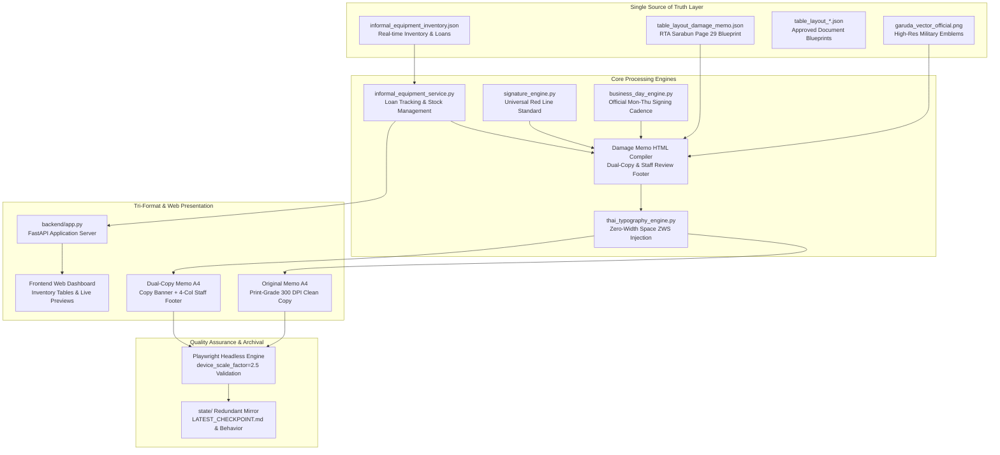

# 🔄 PROJECT FLOW: WEPAPP
> **Language:** English (AI Context Inheritance Standard)  
> **Architecture Pattern:** Multi-Tier SSOT Compiler & Royal Thai Army Production Engine  
> **Revision:** 2026-10-14  

---

## 🏛️ System Architecture Diagram

---

## 🔁 Step-by-Step Execution Workflow

1. **Step 1: Inventory Intake & Loan Tracking**
   - User or operator creates a loan record for equipment in Section 1 (Gun Shed) or Section 2 (HQ Warehouse).
   - System validates available stock balance and reserves quantities atomically in `informal_equipment_inventory.json`.

2. **Step 2: Return & Damage Assessment**
   - On item return, operator records condition:
     - **Normal Return:** Stock balance is restored to the primary storage location.
     - **Damaged Return:** Stock is moved to the repair track (`repair_amount`), recording `cause` and `symptom` separately.

3. **Step 3: Automated RTA Memo Generation**
   - Service loads `table_layout_damage_memo.json` based on *RTA Sarabun 2563 Appendix A Sub-Appendix 1 (Page 29)*.
   - Computes official signing date conforming to the Monday-Thursday business day rule.
   - Interpolates the 3-tier paragraph content (`paragraph_1_reason`, `paragraph_2_intention`, `paragraph_3_summary`).
   - Compiles dual-copy package (Original Copy + Dual Copy with staff review footer).

4. **Step 4: Typography & Micro-Layout Optimization**
   - `thai_typography_engine.py` inserts Zero-Width Space (`\u200b`) between Thai syllables, protecting military abbreviations and HTML tags.
   - Signature block positions the rank end dot exactly collinear with the open parenthesis of the signatory name (Universal Red Line Standard).

5. **Step 5: Visual QA Verification & Archival**
   - Headless browser renders output at 300 DPI (`device_scale_factor = 2.5`).
   - Ensures strict single-page boundary enforcement without overflow.
