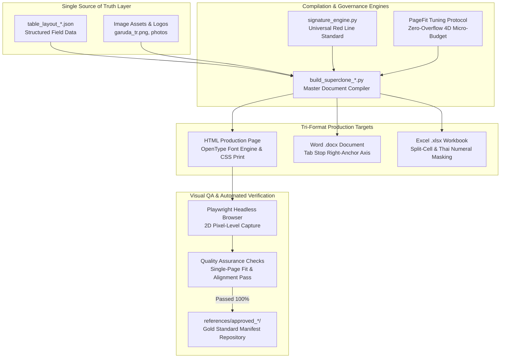

# 🔄 PROJECT FLOW: WEPAPP
> **Language:** English (AI Context Inheritance Standard)  
> **Architecture Pattern:** Multi-Tier SSOT Compiler & Cross-Platform Forensic Engine  
> **Revision:** 2026-10-12  

---

## 🏛️ System Architecture Diagram

---

## 🔁 Step-by-Step Execution Workflow

1. **Phase 1: Input Specification Intake**
   - User inputs specific form requirements or structural modification rules.
   - System checks `GEMINI.md` governance rules (`RULE-PROD-DOC-ENGINE-V1`, `RULE-UNIVERSAL-SIGNATURE-BLOCK-V1`, `RULE-PAGEFIT-TUNING-V1`).

2. **Phase 2: Schema Modeling (SSOT)**
   - All variable fields (memo numbers, dates, topics, inspection findings, signer names/ranks) are isolated into `table_layout.json`.
   - Structural parameters remain strictly separated from volatile content.

3. **Phase 3: Multi-Platform Compilation**
   - **HTML Engine:** Renders `@page` responsive stylesheets, sets Thai OpenType numeral feature tags (`locl`, `numr`), and anchors signature elements via `right: 100%`.
   - **DOCX Engine:** Uses `python-docx` to construct native paragraphs, tables, and tab stops at the exact vertical Red Line axis.
   - **XLSX Engine:** Generates typed cells with openpyxl, formatting numbers with Thai localization tags (`[$-th-TH,26]#,##0.00`).

4. **Phase 4: Visual QA & Zero-Overflow Validation**
   - Playwright captures high-resolution screenshots of every page.
   - Computer vision algorithms analyze vertical projection to ensure 100% zero-overflow across standard A4 boundaries.

5. **Phase 5: Governance Cataloging**
   - User reviews and approves the output (`PASS 100%`).
   - Package is archived under `references/approved_<name>/` with a signed `REFERENCE_MANIFEST.md` and indexed in `GEMINI.md`.
