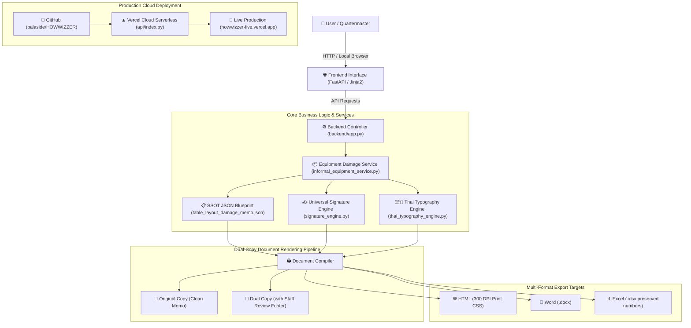
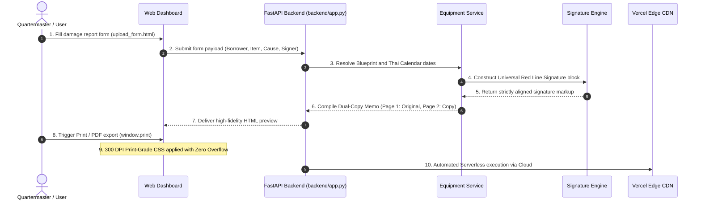

# 🔄 PROJECT ARCHITECTURAL FLOW & DATA PIPELINE (PROJECT_FLOW.md)
> **Language Mandate:** 100% English Version for Context Window Preservation  
> **System:** Royal Thai Army Production Document & Armament Inventory Suite (WEPAPP / HOWWIZZER)  
> **Last Updated:** 2026-10-17  

---

## 🏗️ High-Level System Interaction Map

---

## 🔄 Step-by-Step End-to-End Processing Flow

---

## ⚖️ Business Logic Constraints & Invariants

1. **Working Day Signature Rule:**
   - Official memorandum submission and signature dates must strictly fall between **Monday and Thursday** (excluding official holidays and never on Fridays).
2. **Universal Red Line Signature Rule:**
   - The end period `.` of the rank MUST align vertically with the opening parenthesis `(` of the name (`right: 100%`).
   - Rank is positioned above the signature line (`bottom: calc(100% + 18px)`).
   - In portrait memos, the signature block is indented **130 mm** from the left page margin and spaced **5 Enters** below the concluding paragraph.
3. **Dual-Copy Package Constraint:**
   - Every memo compile command outputs both the Original copy (no staff footer) and the Staff Copy (with the 4-column dual-axis review footer).
4. **Thai Typography Standard:**
   - Primary font: `TH Sarabun PSK` (Bold 600 for headings, Thin 300 for body texts and inspection results).
   - Zero-Width Space insertion prevents word-breaking halfway through syllables.
5. **Vercel Serverless Bundle Limit:**
   - Lambda package must remain under **225 MB** by excluding dev/testing packages (`pytest`) and heavy static documentation directories from deployment.
