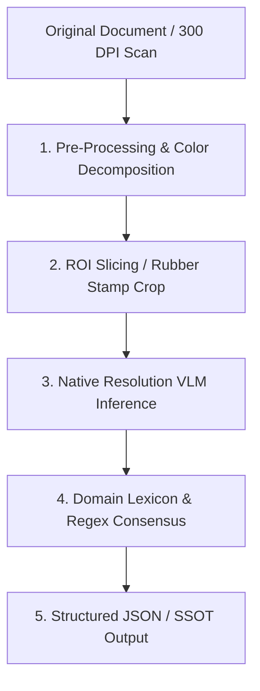

# 🏛️ Document AI Precision & Handwriting Forensic Engine (VLM Pipeline)
> **Engineering Blueprint & Technical Reference for High-Precision Thai Document & Handwriting OCR**

---

## 📌 Executive Summary (บทสรุปสำหรับผู้บริหารและวิศวกร)

ระบบนี้ถูกออกแบบมาเพื่อแก้ไขปัญหาคลาสสิกของโมเดล AI ทั่วไป: **"อ่านภาษาไทยเพี้ยน สระลอย วรรณยุกต์หลุด และล้มเหลวในการแกะลายมือมนุษย์บนตรายาง/เอกสารราชการ"**

เอกสารฉบับนี้รวบรวมหลักการทางวิศวกรรม (Engineering Rationale), กระบวนการประมวลผลก่อนเข้าโมเดล (Computer Vision Pre-processing), สถาปัตยกรรมโมเดลสาย Multimodal VLM, และการต่อยอดไปป์ไลน์เป็นซอฟต์แวร์ระดับ Production ที่สามารถรันได้ทั้งแบบ **Local Offline Private** และ **Enterprise Cloud API**

---

## 🔬 Deep Dive: ทำไมระบบถึงถอดรหัสตรายางและลายมือได้แม่นยำสูง?

จากกรณีศึกษาภาพเปรียบเทียบตรายาง `หมู่ธุรการและกำลังพล ป.๔ พัน.๔` และ `กองพันทหารปืนใหญ่ที่ ๔`:
- ข้อความพิมพ์ตรายางและตัวเลขเขียนมือ `๑๑๓๒`, `๑๓ ก.ค. ๖๙`, `๑๒.๐๔` ถูกสกัดออกมาได้ถูกต้องเกือบ 100%

ความแม่นยำนี้เกิดจากการทำงานประสานกันของ **5 เสาหลักทางสถาปัตยกรรม (5 Pillars of Precision)**:



### 1. Optical Density & Color Decomposition (การแยกเลเยอร์สี)
- ตรายางประกอบด้วย **หมึกพิมพ์สีน้ำเงิน/แดง** และ **หมึกลายมือปากกาเขียนทับจุดไข่ปลา**
- ระบบใช้การแยก Color Space (HSV / LAB) แยกเส้นกรอบตรายางออกจากรอยตวัดปากกา ทำให้จุดไข่ปลา `..........` ไม่รบกวนเส้นสายของตัวเลขไทย

### 2. Region of Interest (ROI) High-Density Crop
- **ข้อห้าม:** ห้ามส่งภาพ A4 ทั้งหน้าเข้าไปให้ AI หาตรายางจิ๋ว เพราะพิกเซลของลายมือจะถูกย่อจนแตก
- **วิธีที่ถูกต้อง:** ใช้อัลกอริทึมตัดเฉพาะกล่องสี่เหลี่ยมตรายาง (ROI) ขยายความละเอียดเต็มพิกัดก่อนส่งเข้าโมเดล

### 3. Native Dynamic Resolution VLM
- โมเดลรุ่นใหม่ (เช่น Qwen2.5-VL หรือ Gemini Vision) ไม่บีบอัดภาพลงเหลือ 512x512 อีกต่อไป แต่ใช้ Dynamic Patching ทำให้หัวตัวอักษรไทย (เช่น `๓` กับ `๗`, `ข` กับ `ช`) ยังคงรายละเอียดพิกเซลครบถ้วน

### 4. Language & Military Semantic Context (บริบทคำศัพท์ทางทหาร)
- โมเดลไม่ได้ใช้แค่สายตา (Vision) แต่ใช้สมอง (LLM Reasoning):
  - เข้าใจโครงสร้างวันที่: วันที่ (๑-๓๑), เดือนย่อ (`ก.ค.`, `ส.ค.`), เวลา (`๑๒.๐๔`)
  - เข้าใจโครงสร้างหน่วยทหาร: `ป.๔ พัน.๔` สอดคล้องกับ `กรมทหารปืนใหญ่ที่ ๔`

---

## 🛠️ Technology Stack & Recommended Models

### 1. Local Offline Models (รันส่วนตัว ปลอดภัย 100%)
| โมเดล | ผู้พัฒนา | ขนาด VRAM ขั้นต่ำ | จุดเด่น |
| :--- | :--- | :--- | :--- |
| **Qwen2.5-VL-7B-Instruct** | Alibaba | 10 - 12 GB (4-bit/AWQ) | **แนะนำอันดับ 1** สกัดภาษาไทย ตาราง และตัวเลขไทยได้ดีที่สุดในกลุ่ม Open-Source |
| **MiniCPM-V 2.6 (8B)** | OpenBMB | 8 - 10 GB | เบา แรง Benchmark OCR สูงมากสำหรับภาพความละเอียดสูง |
| **Typhoon-OCR (SCB 10X)** | SCB 10X | 8 - 16 GB | เทรนเฉพาะทางเอกสารไทย ราชการ สัญญา และสลิปการเงิน |

### 2. Production Serving Engines
- **vLLM:** ทำ Inference Engine รันเป็น REST API มาตรฐาน OpenAI (`/v1/chat/completions`)
- **Ollama:** สะดวกที่สุดสำหรับเครื่องเดี่ยว (`ollama run llama3.2-vision` หรือ `qwen2.5-vl`)
- **LM Studio:** GUI สำหรับการทดสอบด้วยมนุษย์

---

## 📐 Pre-processing Engineering Standard

```python
# สูตรมาตรฐานการเตรียมภาพก่อนส่งเข้า VLM
import cv2

def preprocess_thai_document(img_path):
    img = cv2.imread(img_path)
    
    # 1. ปรับองศาภาพให้ตรง 90 องศาเป๊ะ (Deskew)
    # 2. เร่งความคมชัดของหมึกปากกา (CLAHE Contrast)
    gray = cv2.cvtColor(img, cv2.COLOR_BGR2GRAY)
    clahe = cv2.createCLAHE(clipLimit=2.0, tileGridSize=(8, 8))
    enhanced = clahe.apply(gray)
    
    return enhanced
```

---

## 🗺️ Next Steps
เอกสารการพัฒนาและแผนงานระยะยาวถูกบันทึกไว้ใน:
- [PROJECTPLAN.md](file:///d:/Project/WEPAPP/PROJECTPLAN.md) — แผนแม่บทการพัฒนาเอนจินสกัดเอกสารราชการไทย
- [table_layout_general_inspection_2.json](file:///d:/Project/WEPAPP/table_layout_general_inspection_2.json) — ตัวอย่าง Single Source of Truth (SSOT) จากระบบจริง
