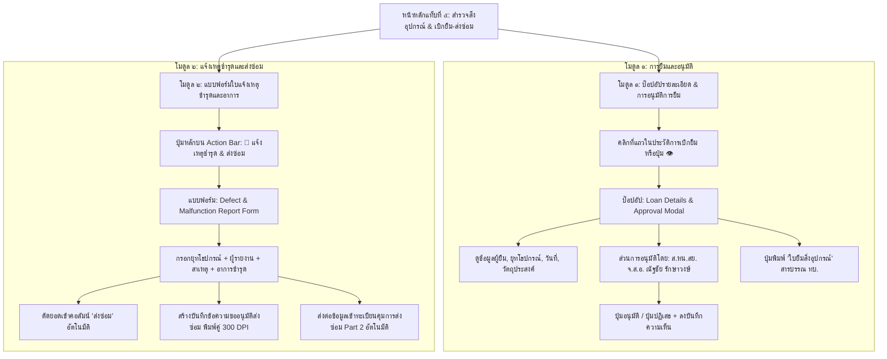

# Design Specification: ระบบใบแจ้งเหตุชำรุดและอาการ & ป๊อปอัปรายละเอียดและการอนุมัติการยืม

**ID:** `SPEC-DEFECT-REPORT-AND-LOAN-APPROVAL-V1`  
**Date:** 2026-10-17  
**Author:** Antigravity (Superpowers Brainstorming)  
**Status:** Approved by User  
**Target Module:** แดชบอร์ดสำรวจสิ่งอุปกรณ์ & เบิกยืม-ส่งซ่อม (Tab 5 / `tab-informal-survey`)

---

## 1. บทนำและวัตถุประสงค์ (Overview & Goals)

ระบบปัจจุบันในส่วนแท็บที่ ๕ (*สำรวจสิ่งอุปกรณ์ & เบิกยืม-ส่งซ่อม (ไม่เป็นทางการ)*) ยังขาด ๒ กลไกสำคัญในการบริหารจัดการยุทโธปกรณ์ภายในกองร้อย:
1. **การขาดแบบฟอร์มบันทึกความชำรุดเสียหาย:** ยังไม่มี "ใบแจ้งเหตุชำรุดและอาการ" ซึ่งจำเป็นต้องใช้เป็นเอกสารตั้งต้น (Template) ในการรวบรวมรายละเอียดสาเหตุและอาการผิดปกติ เพื่อออกหนังสือราชการส่งซ่อมบำรุง
2. **การขาดการเข้าถึงรายละเอียดและการอนุมัติการยืม:** รายการในตารางประวัติการเบิกยืมไม่สามารถคลิกดูรายละเอียดเชิงลึกได้ และยังไม่มีหน้าต่างสำหรับแสดงเนื้อหาการอนุมัติการยืมอย่างเป็นทางการโดยผู้มีอำนาจหน้าที่

สเปกนี้กำหนดรายละเอียดการพัฒนาเพื่อเติมเต็มทั้ง ๒ ฟังก์ชันให้สมบูรณ์ ครบวงจร และถูกต้องตามแบบแผนราชการทหาร

---

## 2. โครงสร้างสถาปัตยกรรม (System Architecture)



---

## 3. ข้อมูลจำเพาะของส่วนประกอบ (Component Specifications)

### 3.1 โมดูลที่ ๑: ป๊อปอัปรายละเอียดและการอนุมัติการยืม (Loan Details & Approval Modal)
* **รหัส DOM:** `#loanDetailsApprovalModal`
* **การเปิดใช้งาน (Trigger):**
  - คลิกที่แถวใดๆ ในตารางประวัติการเบิกยืม (`#informalLoansBody tr`)
  - คลิกปุ่ม `👁️ รายละเอียด/อนุมัติ` ประจำแถว
* **ส่วนแสดงผลรายละเอียด (View Section):**
  - **รหัสการยืม:** รหัสอ้างอิง เช่น `LN-202610-001`
  - **ป้ายสถานะ (Status Pill):**
    - `⏳ รอ ส.หน.สย. อนุมัติ` (Pending Approval)
    - `✅ อนุมัติแล้ว (กำลังเบิกยืม)` (Approved / Active)
    - `⚠️ เกินกำหนดคืน` (Overdue)
    - `✓ คืนเรียบร้อย (ปกติ)` (Returned Normal)
    - `❌ คืน-ชำรุดเสียหาย` (Returned Damaged)
  - **ข้อมูลผู้เบิกยืม:** ยศ, ชื่อ-สกุล, ตำแหน่งสังกัด (เช่น พลปืน ป.หมู่ ๑)
  - **ข้อมูลสิ่งอุปกรณ์:** ชื่อยุทโธปกรณ์, หมวดคลัง (โรงเก็บปืนใหญ่ / คลัง บก.ร้อย), จำนวนที่ยืม
  - **กรอบเวลา:** วันที่ยืม, กำหนดวันที่ (จะ) คืน, วันที่ส่งคืนจริง
  - **วัตถุประสงค์การนำไปใช้:** เช่น การฝึกประจำสัปดาห์, ภารกิจซ่อมบำรุงประจำวัน
* **ส่วนการอนุมัติโดย ส.หน.สย. (Approval Section):**
  - **ผู้อนุมัติ:** ดึงข้อมูลอัตโนมัติจาก `personnel_registry.json`:
    - ตำแหน่ง: **ส.หน.สย. (นายสิบหัวหน้าสายยุทธการ)**
    - ยศ-ชื่อ: **จ.ส.อ. ณัฐชัย รักษาวงษ์**
  - **ช่องความเห็น/เงื่อนไขการอนุมัติ:** กล่องข้อความ (Textarea) ให้ระบุคำสั่งหรือเงื่อนไขการกำกับดูแล
  - **ปุ่มการกระทำ (Actions):**
    - `✅ อนุมัติการยืม`: เปลี่ยนสถานะเป็นอนุมัติแล้ว พร้อมบันทึกประวัติการอนุมัติและเวลา
    - `❌ ปฏิเสธ / ไม่อนุมัติ`: คืนยอดสิ่งอุปกรณ์กลับสู่คงคลังทันที และบันทึกเหตุผล
    - `🖨️ พิมพ์ใบยืมสิ่งอุปกรณ์`: สร้างเอกสารแบบฟอร์มใบยืมสิ่งอุปกรณ์ตามแบบ ทบ. พร้อมช่องลงนามผู้ยืมและ ส.หน.สย.

---

### 3.2 โมดูลที่ ๒: แบบฟอร์มใบแจ้งเหตุชำรุดและอาการ (Defect & Malfunction Report Form)
* **รหัส DOM:** `#defectReportModal`
* **การเข้าถึง (Intake):**
  - ปุ่ม Action ใหม่บนแถบ Action Bar ด้านบน:
    `<button id="btnOpenDefectReport" class="btn-danger">🔴 แจ้งเหตุชำรุด & ส่งซ่อม</button>`
* **ฟิลด์ข้อมูลในแบบฟอร์ม (Form Inputs):**
  1. **สิ่งอุปกรณ์ที่ชำรุด:** Dropdown เลือกจากสิ่งอุปกรณ์ทั้ง ๒ คลัง พร้อมแสดงยอดคงเหลือปัจจุบัน
  2. **จำนวนที่ชำรุด:** ตัวเลข (เริ่มต้น ๑)
  3. **ผู้ตรวจพบ / ผู้รายงาน:** ยศ, ชื่อ-สกุล, ตำแหน่ง
  4. **วันเวลาและสถานที่เกิดเหตุ:** วันที่ตรวจพบ, สถานที่เกิดเหตุ (เช่น สนามฝึกยิง, โรงเก็บปืนใหญ่)
  5. **สาเหตุที่เกิดความชำรุด (Cause of Incident):** กล่องข้อความอธิบายสาเหตุ (เช่น เกิดจากการกระแทกของแข็งใต้ผิวดิน, การล้าของเนื้อโลหะจากการยิงต่อเนื่อง)
  6. **อาการชำรุดที่ตรวจพบ (Symptoms & Breakdown Condition):** กล่องข้อความอธิบายอาการชำรุดอย่างละเอียด (เช่น โครงสร้างบิดงอ, ระบบเกลียวขัดตัว, ชิ้นส่วนแตกหัก)
  7. **ระดับความเร่งด่วน:** ปกติ (Routine) / ด่วน (Priority) / ด่วนที่สุด (Urgent)
  8. **ระบบแนบภาพถ่ายหลักฐานความเสียหายไม่จำกัด (Unlimited Evidence Photo Intake):**
     - ปุ่มกด `📷 เพิ่มภาพถ่ายความชำรุดเสียหาย (ไม่จำกัดจำนวน)`
     - รองรับการเลือกไฟล์หลายภาพพร้อมกัน (Multi-file select), การลากวาง (Drag & Drop) และการ Paste รูปภาพจาก Clipboard
     - กล่องแสดงตัวอย่างภาพ (Evidence Photo Gallery Preview) แสดงภาพขนาดย่อ พร้อมช่องกรอกคำบรรยายภาพ (Caption) เช่น *"มุมมองด้านข้าง แสดงรอยร้าวบริเวณคอคอด"*, *"รอยบิ่นของใบจอบ"* และปุ่มลบภาพ (Remove)
* **กระบวนการทำงานอัตโนมัติเมื่อกดบันทึก (Automation Pipeline):**
  1. **Inventory Reconciliation:** ตัดยอดสิ่งอุปกรณ์นั้นจาก "คงเหลือ" เข้าสู่ช่อง "ส่งซ่อม" ทันทีในฐานข้อมูล `informal_inventory_db.json`
  2. **Photo Evidence Processing:** ประมวลผลภาพถ่ายทั้งหมดและจัดหน้าเป็น **"แผ่นภาพถ่ายประกอบการรายงานส่งซ่อม" (Evidence Photo Appendix Sheet)** มาตรฐาน ทบ. (จัดวาง ๒-๔ ภาพต่อหน้า พร้อมกรอบรูป, คำบรรยายภาพ, และบล็อกรับรองความถูกต้องของภาพถ่าย) แนบท้ายบันทึกข้อความ
  3. **Dual-Copy Memo Compilation:** สร้างเอกสาร *บันทึกข้อความ: รายงานการชำรุดเสียหายและขออนุมัติส่งซ่อม* มาตรฐานราชการ ทบ. 300 DPI ทั้งฉบับตัวจริงและสำเนาคู่ฉบับ โดยในข้อ ๓ และในช่อง "สิ่งที่ส่งมาด้วย" จะระบุยอดภาพถ่ายแนบ เช่น *"ภาพถ่ายความชำรุดเสียหาย จำนวน ๑ แผ่น (๒ ภาพ)"* โดยอัตโนมัติ
  4. **Part 2 Synchronization:** ส่งถ่ายรายการสิ่งอุปกรณ์และภาพหลักฐานเข้าสู่ **Part 2 (ทะเบียนคุมการส่งซ่อม ทบ.๔๐๐-๐๗๑)** โดยอัตโนมัติ

---

## 4. แผนการจัดเก็บข้อมูล (Data Persistence Models)

### 4.1 ข้อมูลการยืม (`loans` ใน `informal_inventory_db.json`)
```json
{
  "loan_id": "LN-202610-001",
  "item_id": "gs_05",
  "item_name": "จอบขุดดิน",
  "quantity": 1,
  "borrower_rank": "ส.อ.",
  "borrower_fullname": "สมชาย รักดี",
  "borrower_position": "พลปืน ป.หมู่ ๑",
  "loan_date": "2026-10-15",
  "expected_return_date": "2026-10-17",
  "actual_return_date": null,
  "purpose": "ปรับปรุงพื้นที่ตั้งยิง ป.หมู่ ๑",
  "status": "pending_approval",
  "approval": {
    "approver_role": "ส.หน.สย.",
    "approver_rank": "จ.ส.อ.",
    "approver_name": "ณัฐชัย รักษาวงษ์",
    "approver_position": "ส.หน.สย.ป.๔ พัน.๔ ร้อย.๒",
    "approved_at": null,
    "approval_note": ""
  }
}
```

### 4.2 ข้อมูลการแจ้งเหตุชำรุด (`defect_reports` ใน `informal_inventory_db.json`)
```json
{
  "defect_id": "DEF-202610-001",
  "item_id": "gs_05",
  "item_name": "จอบขุดดิน",
  "quantity": 1,
  "reporter_rank": "จ.ส.อ.",
  "reporter_name": "สมพงษ์ ทหารกล้า",
  "reporter_position": "ผบ.หมู่ ป.๑",
  "incident_date": "2026-10-17",
  "incident_location": "พื้นที่ตั้งยิง ร้อย.๒",
  "cause": "กระทบชั้นหินแข็งใต้ผิวดินระหว่างขุดสนามเพลาะ",
  "symptom": "ด้ามไม้หักสะบั้นและใบจอบบิดงอผิดรูป ไม่สามารถใช้งานต่อไปได้",
  "urgency": "ด่วน",
  "evidence_photos": [
    {
      "photo_id": "PHT-001",
      "data_url": "data:image/jpeg;base64,...",
      "caption": "ภาพถ่ายมุมกว้าง แสดงสภาพด้ามจอบหักสะบั้น"
    },
    {
      "photo_id": "PHT-002",
      "data_url": "data:image/jpeg;base64,...",
      "caption": "ภาพถ่ายระยะใกล้ แสดงรอยบิ่นคดงอของปลายใบมีดจอบ"
    }
  ],
  "memo_doc_ref": "บันทึกข้อความ_รายงานการชำรุดเสียหาย_Rebuild_Thai.html",
  "transferred_to_part2": true,
  "created_at": "2026-10-17T07:15:00"
}
```

---

## 5. แผนการตรวจสอบและยอมรับงาน (Acceptance Criteria)

1. **การคลิกดูรายละเอียดการยืม:**
   - เมื่อคลิกแถวในตารางประวัติการเบิกยืม หน้าต่าง `#loanDetailsApprovalModal` ต้องเปิดขึ้นมาทันที พร้อมแสดงข้อมูลครบถ้วน
2. **การอนุมัติโดย ส.หน.สย.:**
   - แสดงชื่อ จ.ส.อ. ณัฐชัย รักษาวงษ์ ในฐานะ ส.หน.สย.
   - เมื่อกดปุ่ม "อนุมัติการยืม" สถานะต้องอัปเดตเป็น `อนุมัติแล้ว` ทันที และสามารถพิมพ์ "ใบยืมสิ่งอุปกรณ์" ได้
3. **การบันทึกใบแจ้งเหตุชำรุดและอาการ พร้อมแนบภาพถ่ายไม่จำกัด:**
   - กดปุ่ม `🔴 แจ้งเหตุชำรุด & ส่งซ่อม` จาก Action Bar หน้าต่างกรอกข้อมูลต้องเปิดขึ้นมา
   - สามารถเลือกอัปโหลดภาพถ่ายหลักฐานได้หลายภาพ ไม่จำกัดจำนวน พร้อมระบุคำบรรยายใต้ภาพได้
   - กรอกข้อมูลครบแล้วบันทึก: ยอดสต็อกต้องตัดเข้าช่อง "ส่งซ่อม" ทันที
   - ต้องมีปุ่มเปิดดู "บันทึกข้อความขออนุมัติส่งซ่อม" มาตรฐาน 300 DPI ที่มีแผ่นภาพถ่ายหลักฐานแทรกประกอบอย่างสมบูรณ์
   - ข้อมูลต้องปรากฏในทะเบียนคุมส่งซ่อม Part 2
